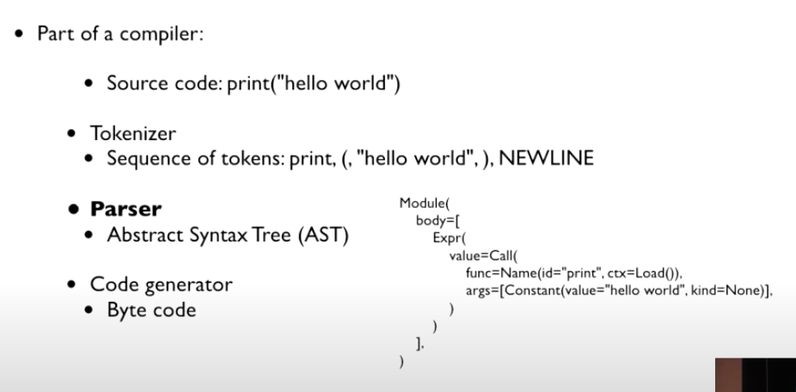

# Objective

- Be able to interpret parser grammar.

 You can find mentions that Python 3.9 introduced a PEG parser. ([https://www.python.org/dev/peps/pep-0617/](https://www.python.org/dev/peps/pep-0617/))
 What's interesting is that in the Performance and validation section of the same document, they mention that the new parser's speed and memory usage came within 10% of the existing parser. ([https://www.python.org/dev/peps/pep-0617/#toc-entry-29](https://www.python.org/dev/peps/pep-0617/#toc-entry-29))

> We have tuned the performance of the new parser to come within 10% of the current parser both in speed and memory consumption.
 While the PEG/packrat parsing algorithm inherently consumes more memory than the current LL(1) parser, we have an advantage because we don't construct an intermediate CST.

 What is the PEG/packrat parsing algorithm mentioned in this part, and what was the existing parsing algorithm like that this kind of difference showed up?
 The PEP isn't claiming a performance improvement of the PEG algorithm itself; it explains that the new parser came within 10% of the existing parser in both speed and memory, and that not constructing a CST is an advantage. If I look into the difference between LL parsers and PEG parsers, I think I'll be able to understand this document in more detail.
 Being able to understand the grammatical parts that will come in Python 3.10 and later is a bonus.

# LL(1) parser

 An LL(1) parser is an LL(k) parser where k=1.
 An LL(k) parser is one kind of LL parser, and here LL means Left-to-right, Leftmost derivation. An LL(k) parser means a parser that holds k lookaheads. An LL(1) parser only holds one lookahead, meaning it parses by looking at only the first value of the input. An LL parser is one of the top-down parsers for context-free languages.

- I said "one of" because there are various parsers like LR, LALR, etc.

## parser

> A **parser** is a software component that takes input data (frequently text) and builds a [data structure](https://en.
wikipedia.org/wiki/Data_structure) – often some kind of [parse tree](https://en.wikipedia.org/wiki/Parse_tree), [abstract syntax tree](https://en.wikipedia.org/wiki/Abstract_syntax_tree) or other hierarchical structure, giving a structural representation of the input while checking for correct syntax.

 Parsing means giving input a structure according to some rules, and a parser seems to mean the algorithm that does parsing.

 That's the semantic meaning, and in the Python implementation it means the program that creates a parse tree between the token generator and the code generator.
 When the token generator looks at the input string and tokenizes it, the parser takes those tokens and creates an AST. The code generator takes the AST and makes bytecode.

{: width="796" height="392" loading="eager" decoding="async"}

## top-down parser

> **Top-down parsing** in [computer science](https://en.wikipedia.org/wiki/Computer_science) is a [parsing](https://en.wikipedia.org/wiki/Parsing) strategy where one first looks at the highest level of the [parse tree](https://en.wikipedia.org/wiki/Parse_tree) and works down the parse tree by using the rewriting rules of a [formal grammar](https://en.wikipedia.org/wiki/Formal_grammar).

A top-down parser means a method of applying the rules of a formal grammar while going down from the very top of the parse tree.
For example, let's say the input is `aefgh`, the grammar rules are `A → aBC, B → bd | ef, C → ce | gh`, and A is the parser's starting point.
The tree would look roughly like this.

```
A -> aBC -> abdC -> abdce
                 \-> abdgh
         -> aefC -> aefce
                 \-> aefgh
```

 I think they also call this tree a parse tree.

## formal grammar

 Rules that tell you how the basic building blocks of a language can be composed.
 It's composed of a set of production rules of a formal language.

## Parsing with LL(k) parser

 To parse with an LL(k) parser, you need three things: an input buffer, a stack, and a parsing table.
 The input buffer is literally the place where the input tokens exist. An LL(k) parser can inspect k of the tokens in the input buffer, but it inspects them without consuming them.

 The stack is a data structure that piles up the interpreted rules.
 Elements that can go on the stack are non-terminals, terminals, or the empty string, where a non-terminal means a token that can be interpreted through rules and a terminal means a token to which no more rules can be applied.
 Initially the stack has the start symbol and EOI (End of input).
 EOI also exists at the end of the input buffer, so when you look at both the stack and the input buffer and EOI comes out, you can consider it terminated.

 With the start symbol on the stack, the parser can take two actions.

1. When the result X of applying a rule to the value at the very top of the stack is a non-terminal. Put that result back onto the stack in order and pop the top value again.
2. When X is a terminal or empty string. If the next token (1) of the input buffer matches X, remove that token from the input stream and also remove it from the stack. If it doesn't match, reject the input. (The k lookaheads are used when choosing which rule to apply to a non-terminal.)

 If while proceeding the value popped from the stack is EOI, stop parsing and treat it as success.

```
Input buffer: '1' - '+' - '2' - '+' - '3'
Stack: [S, $]
```

### Parsing table

 To actually implement a parser you need a way to apply rules, so you implement a parsing table and refer to the rules from it.
 A parsing table is implemented like this.

- Rows: the top value popped from the stack
- Columns: input tokens
- Values: the rule to apply

 Since you'd have to put every possible input combination in the columns, the size of the parsing table grows exponentially with respect to k.

```
Parsing table:
-   |   a   |   b   |   c   |   d   |   e   |
---------------------------------------------
A   |   1   |   -   |   -   |   -   |   -   |
---------------------------------------------
B   |   -   |   2   |   2   |   -   |   -   |
---------------------------------------------
C   |   -   |   -   |   -   |   3   |   3   |
---------------------------------------------
```

 An LL(1) parser uses the FIRST and FOLLOW functions to implement the parsing table.
 If you just want to understand it conceptually you only need to know FIRST, and FIRST is the first token of the output you can ultimately get when interpreting A.
 For example, if there are rules A → Bd, B → Ce, C → df, A ultimately becomes the letters dfed so FIRST(A) = d. 

# PEG parser

PEG is short for parsing expression grammar, and it means a grammar that uses parsing expressions.
Here a parsing expression seems like it can be seen as something like a pattern that recognizes a string, similar to a regular expression.

## Parsing expression Grammar

 The basic elements of PEG, like other parsers, are non-terminals, terminals, and empty string.
 In PEG a rule is written in the form `A <- e`, where e corresponds to the parsing expression.
 LL was in the form `A -> alpha`, meaning A is always replaced with alpha, whereas for PEG it seems you can roughly see it as changing A if the parsing expression e is satisfied.
 The subject of recognition is different.
 The smallest components of a parsing expression, atomic parsing expressions, are composed of terminals, non-terminals, and empty string, and you can combine parsing expressions according to rules of about this level.

- sequence: e = e1e2
- ordered choice: e = e1 | e2
- zero or more: e = e1*
- one or more: e = e1+
- optional: e = e1?
- and: e = &e1
- not: e = !e1

 Sequence requires e1 to be satisfied and then e2 to be satisfied.
 If e1 fails, e2 is not examined. Ordered choice stops if e1 is satisfied, and if e1 is not satisfied it backtracks the input buffer to the point where it started examining e1 and starts examining e2 from that point. 

 The biggest difference between the LL parser family and PEG parsers shows up in ordered choice.
 When there are several choices, the LL parser family considers all cases and becomes ambiguous if FIRST(e) is the same in two or more cases, whereas ordered choice selects the very first match.
 Because of this, in PEG there is no ambiguity and the parse tree is determined as exactly one.

 You can also see the difference between LL grammar and PEG in zero or more or one or more: LL(k) grammar uses a finite lookahead, whereas PEG grammar can use lookahead proportional to the number of inputs, so memory usage is proportional to the input.

 While other expressions consume input if the condition is satisfied, and or not expressions are expressions that don't consume input, called semantic predicates.
 Similar to the boolean expressions we commonly know, and passes if the condition is satisfied and otherwise sends you to keep backtracking going forward (it doesn't stop immediately!)

## Parsing with PEG parser

## Limitations

 Because they use unlimited lookahead, they can show exponential time performance.
 To compensate for this, a packrat parser is used.

### packrat parser

 While going down the parse tree, it memoizes all results so that the parse function is applied at most once for each input position.
 Memory usage becomes enormous, but instead execution always terminates in linear time.

# Why Python switched to a PEG parser

## Problems that are hard to solve with the current LL(1) parser

### Left recursion

 First of all, left recursion doesn't work.
 If you do it with LL(1), left recursion loops indefinitely, so you can't use it unless you cut it off in the middle.

### Code generator needs to be modified

 They say that if you modify the grammar the shape of the parse tree changes, so you also have to modify the code generator.
 The problem is that the code generator is said to be quite hard to modify.
 So around 2005 they put the AST that the code generator accepts, made a CST that the parser creates, and made yet another translator program that converts CST to AST.
 Thanks to this they could modify the grammar without modifying the code generator, but now they say you have to modify the translator program.
 This was about 6,000 lines of C code so maintenance was extremely hard, they say.
 They especially felt it a lot while making the walrus opertor.
 On top of that, both the CST and AST having to be in memory is a bonus.

## Advantages when switching to PEG

### Left recursion

 left recursion is possible.
 This is originally impossible with classic PEG. CPython, like the Medeiros et al. / Warth et al. approach, handles left recursion by starting from failure and iteratively growing a seed.
 In LL there is no ordered choice or backtracking so it probably would have been impossible.

### Performance improvement

 Even when Guido presented it, they said that when compiled to C the speed was almost the same and memory used a bit more.
 I guess they thought memory is cheap these days so it's not much of a problem. According to the PEP that announced the PEG release, the new parser came within 10% of the existing parser in both speed and memory. ([PEP 617](https://peps.python.org/pep-0617/))

### More powerful interpretation

 Even if it uses more memory, it can interpret more powerfully than an LL(1) parser.
 Because as we saw above PEG interprets based on expressions and uses infinite lookahead.

### More natural grammar

 The grammar becomes more natural than using LL, and they say that when they used LL there were parts that were grammatically problematic that they used with slight modifications.
 If you use PEG there are parts that are resolved grammatically, so they say you can express the grammar naturally without using minor tweaks.
 The part that actually helps us is when predicting the actual implementation from the grammar documentation, and they say the grammar docs are said to be the same as the implementation but actually they're not.

### Grammar action

 Being able to generate an AST directly using something called a grammar action is also an advantage.
 Thanks to this, if you use a PEG parser you don't have to use a CST and a translator program, which they say would be an advantage from a maintenance perspective. 
