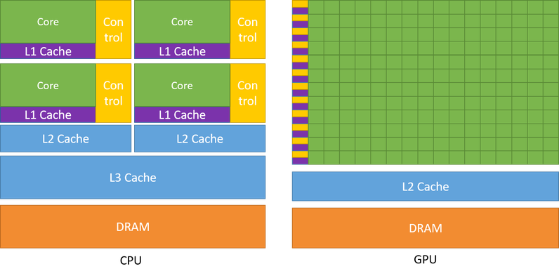
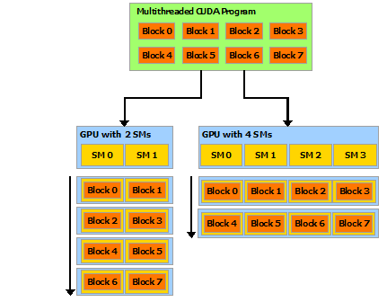
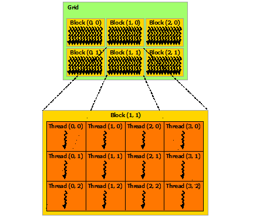
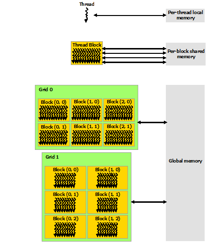

# TL;DR

Q: Why is there an initial wait when running on GPU?

A: The CUDA runtime is initialized the first time a runtime function runs, and the initialization process includes initializing a CUDA context, which is similar to a host process, and a CUDA module, which is similar to a DLL, so an initial wait can occur.

# Content

https://docs.nvidia.com/cuda/cuda-c-programming-guide/index.html#cuda-general-purpose-parallel-computing-architecture 

> The CUDA parallel programming model is designed to overcome this challenge while maintaining a low learning curve for programmers familiar with standard programming languages such as C.

> At its core are three key abstractions - a hierarchy of thread groups, shared memories, and barrier synchronization - that are simply exposed to the programmer as a minimal set of language extensions.

> These abstractions provide fine-grained data parallelism and thread parallelism, nested within coarse-grained data parallelism and task parallelism. They guide the programmer to partition the problem into coarse sub-problems that can be solved independently in parallel by blocks of threads, and each sub-problem into finer pieces that can be solved cooperatively in parallel by all threads within the block.

> This decomposition preserves language expressivity by allowing threads to cooperate when solving each sub-problem, and at the same time enables automatic scalability. Indeed, each block of threads can be scheduled on any of the available multiprocessors within a GPU, in any order, concurrently or sequentially, so that a compiled CUDA program can execute on any number of multiprocessors as illustrated by Figure 3, and only the runtime system needs to know the physical multiprocessor count.

{: width="796" height="393" loading="eager" decoding="async"}

{: width="431" height="336" loading="lazy" decoding="async"}

It uses thread group, shared memory, barrier synchronization. Using these, a worker can split a problem into smaller problems and have each problem run in parallel on threads. Each thread block is assigned to an available GPU multiprocessor.

## Kernel

> CUDA C++ extends C++ by allowing the programmer to define C++ functions, called kernels, that, when called, are executed N times in parallel by N different CUDA threads, as opposed to only once like regular C++ functions.

A kernel is a C++ function, and it runs on N different CUDA threads (hereafter threads).

## Thread structure

> For convenience, threadIdx is a 3-component vector, so that threads can be identified using a one-dimensional, two-dimensional, or three-dimensional thread index, forming a one-dimensional, two-dimensional, or three-dimensional block of threads, called a thread block. This provides a natural way to invoke computation across the elements in a domain such as a vector, matrix, or volume.

A thread index (a value for uniquely referring to a thread) is made of a 3-element vector. It can be expressed as a 1D, 2D, or 3D thread index. This way you can naturally do computation on a vector, matrix, or volume.

> The index of a thread and its thread ID relate to each other in a straightforward way: For a one-dimensional block, they are the same; for a two-dimensional block of size (Dx, Dy),the thread ID of a thread of index (x, y) is (x + y Dx); for a three-dimensional block of size (Dx, Dy, Dz), the thread ID of a thread of index (x, y, z) is (x + y Dx + z Dx Dy).

You can represent a thread's position inside a block with the block size and the thread number.

{: width="431" height="374" loading="lazy" decoding="async"}

There are several blocks of the same size, and in one block threads sit in the same count each, in this form.

> Threads within a block can cooperate by sharing data through some shared memory and by synchronizing their execution to coordinate memory accesses. More precisely, one can specify synchronization points in the kernel by calling the __syncthreads() intrinsic function; __syncthreads() acts as a barrier at which all threads in the block must wait before any is allowed to proceed. Shared Memory gives an example of using shared memory. In addition to __syncthreads(), the Cooperative Groups API provides a rich set of thread-synchronization primitives.

> For efficient cooperation, the shared memory is expected to be a low-latency memory near each processor core (much like an L1 cache) and __syncthreads() is expected to be lightweight.

Threads in a block can cooperate using shared memory and synchronizing.

## Memory structure

> CUDA threads may access data from multiple memory spaces during their execution as illustrated by Figure 5. Each thread has private local memory. Each thread block has shared memory visible to all threads of the block and with the same lifetime as the block. All threads have access to the same global memory.

> There are also two additional read-only memory spaces accessible by all threads: the constant and texture memory spaces. The global, constant, and texture memory spaces are optimized for different memory usages (see Device Memory Accesses). Texture memory also offers different addressing modes, as well as data filtering, for some specific data formats (see Texture and Surface Memory).

> The global, constant, and texture memory spaces are persistent across kernel launches by the same application.

{: width="431" height="503" loading="lazy" decoding="async"}

Each thread can access memory as shown in the figure. All threads can access global memory.

Besides global memory there are two read-only memories, constant and texture memory. constant and texture memory are optimized for different purposes.

## Heterogenous Programming

> As illustrated by Figure 6, the CUDA programming model assumes that the CUDA threads execute on a physically separate device that operates as a coprocessor to the host running the C++ program. This is the case, for example, when the kernels execute on a GPU and the rest of the C++ program executes on a CPU.

> The CUDA programming model also assumes that both the host and the device maintain their own separate memory spaces in DRAM, referred to as host memory and device memory, respectively. Therefore, a program manages the global, constant, and texture memory spaces visible to kernels through calls to the CUDA runtime (described in Programming Interface). This includes device memory allocation and deallocation as well as data transfer between host and device memory.

> Unified Memory provides managed memory to bridge the host and device memory spaces. Managed memory is accessible from all CPUs and GPUs in the system as a single, coherent memory image with a common address space. This capability enables oversubscription of device memory and can greatly simplify the task of porting applications by eliminating the need to explicitly mirror data on host and device. See Unified Memory Programming for an introduction to Unified Memory.

When doing CUDA programming, you assume CUDA threads run on a device physically separate from the device (host) running the C++ program.

You also assume host has host memory and device has device memory. A program running on the host looks at global, constant, texture memory through the CUDA runtime (host), or does host-device memory allocation/deallocation.

Besides host and device memory there is unified memory. host and device can both access it using a shared address space.

## Programming Interface

> The core language extensions have been introduced in Programming Model. They allow programmers to define a kernel as a C++ function and use some new syntax to specify the grid and block dimension each time the function is called. A complete description of all extensions can be found in C++ Language Extensions. Any source file that contains some of these extensions must be compiled with nvcc as outlined in Compilation with NVCC.

The language extension lets you write a kernel as a C++ function, and code that includes this extension must be compiled with NVCC.

> The runtime is introduced in CUDA Runtime. It provides C and C++ functions that execute on the host to allocate and deallocate device memory, transfer data between host memory and device memory, manage systems with multiple devices, etc.

The CUDA runtime provides functions that can allocate/deallocate/send and receive device memory and so on, on the host.

> The runtime is built on top of a lower-level C API, the CUDA driver API, which is also accessible by the application. The driver API provides an additional level of control by exposing lower-level concepts such as CUDA contexts - the analogue of host processes for the device - and CUDA modules - the analogue of dynamically loaded libraries for the device. Most applications do not use the driver API as they do not need this additional level of control and when using the runtime, context and module management are implicit, resulting in more concise code. As the runtime is interoperable with the driver API, most applications that need some driver API features can default to use the runtime API and only use the driver API where needed.

The CUDA runtime is built on the CUDA driver API. The CUDA driver API exposes a layer that controls CUDA context and CUDA modules. Usually you don't need it, but if you do you can also use it through the runtime.

## CUDA Runtime

> There is no explicit initialization function for the runtime; it initializes the first time a runtime function is called (more specifically any function other than functions from the error handling and version management sections of the reference manual). One needs to keep this in mind when timing runtime function calls and when interpreting the error code from the first call into the runtime.

The runtime is initialized the first time it's called, so you need to know that.

> The runtime creates a CUDA context for each device in the system (see Context for more details on CUDA contexts). This context is the primary context for this device and is initialized at the first runtime function which requires an active context on this device. It is shared among all the host threads of the application. As part of this context creation, the device code is just-in-time compiled if necessary (see Just-in-Time Compilation) and loaded into device memory.

The runtime creates a CUDA context for each device. This context becomes that device's primary context, and is initialized when the first runtime function that needs that device's active context runs. It's shared across all threads of the application. The context is JIT-compiled on the device (if needed) and loaded into device memory.

## CUDA Context

> A CUDA context is analogous to a CPU process. All resources and actions performed within the driver API are encapsulated inside a CUDA context, and the system automatically cleans up these resources when the context is destroyed. Besides objects such as modules and texture or surface references, each context has its own distinct address space. As a result, CUdeviceptr values from different contexts reference different memory locations.

A CUDA context is something like a CPU process; resources and actions performed in the driver API are wrapped in a CUDA context. When the context is removed, the resources are removed too.

## CUDA module

> Modules are dynamically loadable packages of device code and data, akin to DLLs in Windows, that are output by nvcc (see Compilation with NVCC). The names for all symbols, including functions, global variables, and texture or surface references, are maintained at module scope so that modules written by independent third parties may interoperate in the same CUDA context.

A module includes packages, code, data.
