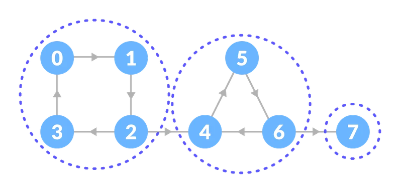
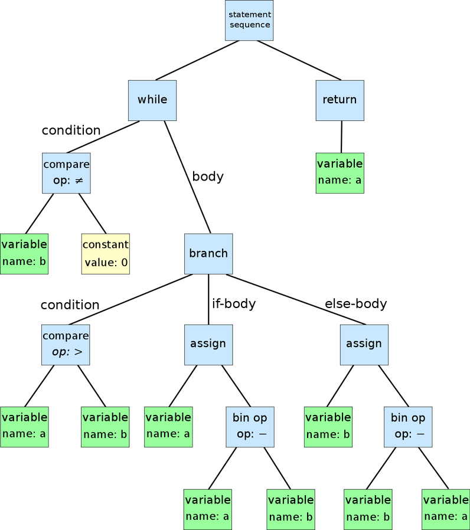
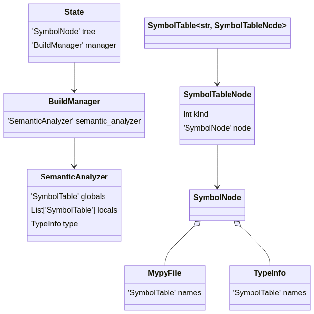
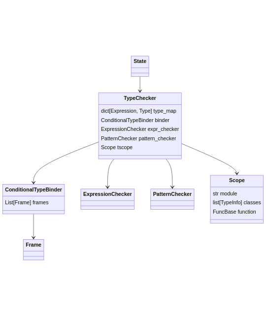

This is content I organized by looking at the code about (part of) the process by which mypy type-checks.

I put a more detailed and friendly explanation in the [later post series](/en/mypy-1-pre-optimization.html).

# Overview of the interpretation process

1. Read files/directories.
2. Build a dependency graph.
3. Split the graph into sccs.
4. Topsort the sccs in dependency order. (root last)
5. For each scc, do the following.
    1. When a stale scc is encountered, process fresh sccs in advance.
    2. For stale sccs, do the following.
        1. Parse the file. (consistency check)
        2. Run semantic analysis.
        3. Type-check.

# Build a dependency graph.

In this stage, BuildSource is converted to State and stored in Graph. You can look at BuildSource as a module, and State as module + state values. Graph is a dictionary that maps module names and States. The Graph is initialized through the following process.

1. Construct Graph so it's {module name: State}.
2. Add to each State the dependencies the module had.
    1. For the module's anscestor, direct dependency, do the following. Indirect dependencies are excluded because if they change after being cached there's a possibility they can't be inferred properly.
        1. If the module can't be found or was already added, move on to the next module.
        2. Make that module into a State.
            1. The relationship between that module and the original module is recorded on the State.
        3. Add it to Graph.
        4. Include the created State at the very end of the list of modules to process in step 2.
            1. Meaning once you process a dependency you do the same operation again for that dependency. BFS approach.

Once this stage is complete, it becomes a state where the target files are inside Graph.

# Split the graph into sccs.

The intent isn't clearly stated in the code or docs, but reconstructing the dependency graph into SCCs seems to be in order to handle circular references well. As also shown in the figure above, if you split a graph that has cycles into SCCs, and look at each SCC as one node, the whole graph becomes a DAG(Directed Acyclic Graph) and becomes relatively easier to handle.

## SCC?

{: width="796" height="385" loading="eager" decoding="async"}

> A strongly connected subgraph, S, of a directed graph, D, such that no vertex of D can be added to S and it still be strongly connected. Informally, a maximal subgraph in which every vertex is reachable from every other vertex. [ref](https://xlinux.nist.gov/dads/HTML/stronglyConnectedCompo.html)

# Topsort the sccs in dependency order.

To process the node that should be processed first first, topologically sort the graph based on dependencies. If we call the node that should be processed first a leaf node, if we process in the leaf-to-root direction, the reference values we need to know in the next stage get revealed in this stage. Here let's think of a leaf node as a node that no longer has fan-out, for example a basic module like typing, and a root node as a node with no fan-in, for example a module written in the application.

## Tip

### Checking the processing order

If you turn on the `--verbose` option you can check which SCC is processed in what order.

### Not caching

You have to not use caching with the `--cache-dir=/dev/null` option to be able to check every time.

#### Example

```
> mypy ~/src/myproject/app/constants.py --verbose --cache-dir=/dev/null
LOG:  Found 6 SCCs; largest has 34 nodes
LOG:  Processing SCC of size 34 (typing_extensions typing types sys subprocess posixpath pathlib os.path os mmap io importlib.metadata importlib.machinery importlib.abc importlib genericpath email.policy email.message email.header email.errors email.contentmanager email.charset email ctypes contextlib collections.abc collections codecs array abc _typeshed _collections_abc _ast builtins) as inherently stale
LOG:  Processing SCC singleton (enum) as inherently stale
LOG:  Processing SCC singleton (common) as inherently stale
LOG:  Processing SCC singleton (app) as inherently stale
LOG:  Processing SCC singleton (common.constants) as inherently stale
LOG:  Processing SCC singleton (app.constants) as inherently stale
```

### Checking the generated graph

If you use the `--dump_graph` option you can check the dependency graph made through this stage!

#### Example

```
> mypy app/constants.py --cache-dir=/dev/null --dump-graph
[["n0", 101825, ["_ast", "typing_extensions", "types", "ast", "abc", "typing", "_typeshed", "builtins", "sys", "_weakrefset", "mmap", "array", "collections"],
     {"_ast": 5288, "typing_extensions": 2910, "types": 5356, "ast": 1155, "abc": 1155, "typing": 17947, "_typeshed": 4464, "builtins": 48266, "sys": 3524, "_weakrefset": 2181, "mmap": 1797, "array": 3023, "collections": 4759},
     {}],
 ["n1", 43, ["common"],
     {"common": 43},
     {}],
 ["n2", 76933, ["common.constants"],
     {"common.constants": 76933},
     {"n0": 5}],
 ["n3", 0, ["app"],
     {"app": 0},
     {}],
 ["n4", 415645, ["app.constants"],
     {"app.constants": 415645},
     {"n0": 5, "n2": 5}]
]
```

#### Interpretation

- The leaf node is the n0 node. Modules like ast, abc, typing, sys are doing circular references so they're inside one SCC.
- Below that, modules continue in dependency order. Because each module has no circular references, there's only one module inside each SCC.
- The root node is the n4 node at the very bottom. The target module app.constants is located there.
- The {"n0": 5, "n2": 5} at the very end means this node's dependencies. There are dependencies on the n0, n2 nodes. The number means priority, and 5 means it was imported in a form like from X import Y.
- I didn't look at priority in detail but it seems to be information used to decide the processing order within an SCC. 

# When a stale scc is encountered, process fresh sccs in advance.

## stale? fresh?

mypy caches previously processed content. When newly running, modules confirmed to be cached are distinguished as fresh, ones that aren't as stale.

If the whole scc is fresh it takes information from the cache(=”processes”), and sccs that aren't go on to the interpretation stage.

## Tip

The cache is stored in .mypy_cache in json file form. The content that goes into State is stored.

### Example

If you look at the example below you can roughly check the content mypy interpreted.

```
{
	".class": "MypyFile",
	"_fullname": "app.constants",
	"future_import_flags": [],
	"is_partial_stub_package": false,
	"is_stub": false,
	"names": {
		".class": "SymbolTable",
			"SOME_CONSTANT": {
				".class": "SymbolTableNode",
				"kind": "Gdef",
				"node": {
					".class": "Var",
					"flags": ["has_explicit_value"],
					"fullname": "app.constants.SOME_CONSTANT",
					"name": "SOME_CONSTANT",
					"type": {".class": "Instance", "args": ["builtins.int"], "type_ref": "builtins.list"}}},
	...
}
```

# Parse the file.

This is the process of taking the file content and making it into an AST node tree. The ast library does the parsing.

## AST?

{: width="796" height="898" loading="lazy" decoding="async"}

> In computer science, an abstract syntax tree (AST), or just syntax tree, is a tree representation of the abstract syntactic structure of text (often source code) written in a formal language. Each node of the tree denotes a construct occurring in the text. [ref](https://en.wikipedia.org/wiki/Abstract_syntax_tree)

## ast library? 

> The ast module helps Python applications process trees of the Python abstract syntax grammar.
You can generate an abstract syntax tree by passing ast.PyCF_ONLY_AST as a flag to the compile() built-in function, or by using the parse() helper provided by this module. The result is a tree of objects whose classes all inherit from ast.AST. You can compile an abstract syntax tree into a Python code object using the compile() built-in function. [ref](https://docs.python.org/ko/3/library/ast.html)

```
Python 3.10.4 (main, Apr  8 2022, 17:35:13) [GCC 9.4.0] on linux
Type "help", "copyright", "credits" or "license" for more information.
>>> import ast
>>> p = ast.parse('print("hello, world!")')
>>> print(ast.dump(p, indent=4))
Module(
    body=[
        Expr(
            value=Call(
                func=Name(id='print', ctx=Load()),
                args=[
                    Constant(value='hello, world!')],
                keywords=[]))],
    type_ignores=[])
```

## Step explanation

Here it doesn't type-check or do semantic analysis; it does the appropriate operations to convert AST nodes into classes specified by mypy.

For example, like this.

```python
def visit_Return(self, n: ast3.Return) -> ReturnStmt:
    node = ReturnStmt(self.visit(n.value))
    return self.set_line(node, n)
```

Once we get here, it becomes a state where an AST in a form mypy can understand has been made for the target module.

# semantic analysis

In mypy, Semantic analysis, broadly speaking, is the process of filling SymbolTable with SymbolTableNodes. The objects that mainly participate are as in the figure. For convenience most of the relationships were omitted.

{: width="643" height="642" loading="lazy" decoding="async"}

## Interpretation

### Objects

- State: One module of the SCC that's the analysis target.
- BuildManager : An object that holds state values throughout the whole process.
- SemanticAnalyzer : In charge of semantic analysis. Visitor pattern.
- SymbolTable : A mapping of namespace - SymbolTableNode.
- SymbolTableNode : Specifies what kind the SymbolNode corresponding to an AST node is. The same node could be defined as global, member, local so it splits the kind.
- SymbolNode: Similar if you think of it as a mypy-version AST node.
- MypyFile : One file. Similar to module in AST.
- TypeInfo : A bundle of type definitions that corresponds 1:1 with a class definition.
### Analysis process
- State means the module that's the analysis target. As described above, it's convenient to look at State as module + state values.
- State holds a SymbolNode called “tree”. “tree” means the root of the AST that represents the module.
- State holds a BuildManager. BuildManager holds state values that should be used throughout the whole build process.
- BuildManager references the SemanticAnalyzer that should be used.
- SemanticAnalyzer holds a global SymbolTable called “globals”, a list of SymbolTables defined per function called “locals”, and a TypeInfo called “type” that indicates what type's scope it's currently in.
- SymbolTable is a dictionary that represents a specific namespace. It maps names and SymbolTableNodes. For example if a constant called c is defined, it's stored in SymbolTable in a form like {'c': SomeSymbolTableNode}.

The analysis process starts as SemanticAnalyzer visits State's tree. Because SemanticAnalyzer is a Visitor pattern, if you want to see how a node of a specific type is handled, look for visit_~~~.

Each type of node follows its own logic but in the end it's not that different from what Python defines. There are many to look at one by one specifically so let's start from one function and check roughly how it goes.

- e.g. If there's a statement x = y, how would mypy handle this statement? (explanation WIP)
    - [mypy code](https://github.com/python/mypy/blob/master/mypy/semanal.py#L2055)

When this process is done, the analysis target's SymbolTable is filled.

# Type checking

The role of mapping expression AST nodes with types. Infers a type for each subexpression AST node. Below is the relationships between objects in the type-checking stage; for convenience most were omitted.

{: width="540" height="642" loading="lazy" decoding="async"}

## Interpretation

### Objects

- TypeChecker: In charge of type checking. Visitor.
- ConditionalTypeBinder: Tracks Conditional type. 
- Frame: Means an execution point. Stores types that should be known at the current execution point.
- ExpressionChecker: In charge of type checking the expression the node holds. Visitor.
- PatternChecker: In charge of type checking when a pattern needs to be checked. Visitor.
- Scope: Stores the scope currently being processed.
- PartialTypeScope: Types whose inner type isn't decided yet like list(), or types specified as None, are called PartialType.

### Analysis process

- State means the same object used in the previous stage.
- TypeChecker performs type inspection on nodes of SymbolNode type.
- If a node includes an expression, ExpressionChecker performs type inspection on it. For example in the case of AssigmentStmt(e.g. x=y is None) the rvalue is an expression.
- PatternChecker performs type inspection on pattern matching. For now there are no uses besides match-case.
- There are times when a variable's type is decided at a specific point, like Isinstance. ConditionalTypeBinder stores type information for cases where a variable's type differs per branch.
- ConditionalTypeBinder holds several Frames inside a stack.
- Frame means a specific execution point. A name-to-type mapping is stored in Frame. For example if you went down the if isinstance(x, Type) branch, Type is stored for x in the Frame that means the current execution point.
- Scope holds information about what scope it's currently in. If it's processing a specific module, it's a way that the current module name goes into module.

Type checking also approaches each one differently so there are many cases and it's not easy to generalize or look at them one by one. Let's pick just a few examples to look at, but let's look with a focus on the questions below.

1. If there's a statement x = y, how would it type-check? (explanation WIP)
    - [mypy code](https://github.com/python/mypy/blob/master/mypy/checker.py#L2210)
2. Under if isinstance(variable, Type): it always thinks of variable's type as Type. How does it do that? (explanation WIP)
    - [mypy code](https://github.com/python/mypy/blob/master/mypy/checker.py#L3592)
3. How does it bring in and use types defined in an external library? (explanation WIP)
    > … The answer is that mypy comes bundled with stub files from the the typeshed project, which contains stub files for the Python builtins, the standard library, and selected third-party packages.
        - [mypy wiki](https://mypy.readthedocs.io/en/stable/getting_started.html#stubs-files-and-typeshed)

# Ideas

- You could use the --dump-graph option to check circular references.
- When you need to check the exact definition of a referenced value, you could use the content stored in the SymbolTable filled in the Semantic analysis stage.
