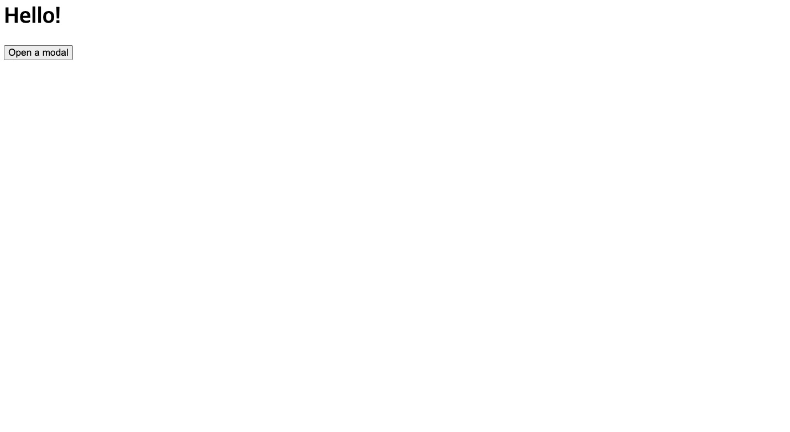
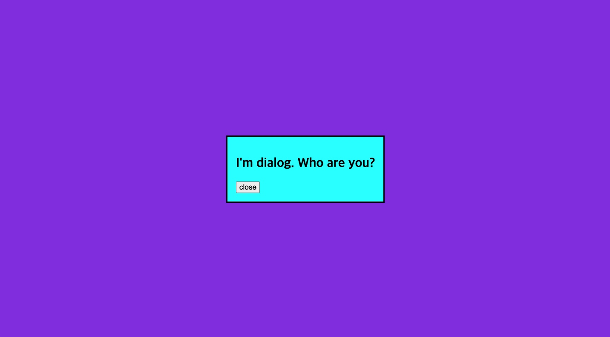

After seeing [an article shared](https://tomquinonero.com/blog/native-html-modals-with-the-dialog-tag?utm_source=hada) on [GeekNews](https://news.hada.io/new), I wondered whether using the dialog tag might mean I don't have to implement modals myself when developing going forward, so I made a simple example and tested it.

I've seen a lot of cases of implementing modals by hand; it was probably for customization, but it seems convenient when you want a simple implementation.

# Example

## Code

```html
<html>
    <head>
        <title>Dialog test</title>
        <link rel="stylesheet" href="index.css">
    </head>
    <body>
        <h1>Hello!</h1>
        <button id="modal-button" data-modal="modal">Open a modal</button>
        <dialog id="modal">
            <h2>I'm dialog. Who are you?</h2>
            <button id="close-dialog">close</button>
        </dialog>
        <script>
            const button = document.getElementById('modal-button')
            button.addEventListener('click', (event) => {
                const modal = document.getElementById('modal')
                modal.showModal()
            })

            const closeButton = document.getElementById('close-dialog')
            closeButton.addEventListener('click', (event) => {
                const modal = event.target.closest('dialog')
                modal.close()
            })
        </script>
    </body>
    <style>
        dialog {
            background-color: aqua;
        }

        dialog::backdrop {
            background-color: blueviolet 
        }
    </style>
</html>
```

## Run example

{: width="1430" height="783" loading="eager" decoding="async"}
Initial HTML screen.

{: width="1432" height="791" loading="lazy" decoding="async"}
The screen that appears when you click the "Open a modal" button.
You can see that the background color on the backdrop changed the background color behind this modal.
