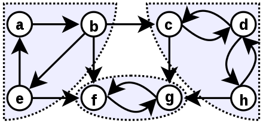

# Introduction

This post is a collection of things I studied about mypy on the side while writing [mypyind](https://github.com/yangkyeongmo/mypyind), which finds callers of a specific function in a large-scale Python project.

This is additional explanation for a [pycon talk](/en/i-present-on-pycon-2023.html).

This post is connected to the posts below.

[How Mypy Works: #1 Pre-optimization (current post)](/en/mypy-1-pre-optimization.html)

[How Mypy Works: #2 File Parsing](/en/mypy-2-parsing.html)

[How Mypy Works: #2-side Why Does Mypy Need AST?](/en/mypy-2-1-why-ast.html)

[How Mypy Works: #3 Semantic Analysis](/en/mypy-3-semanal.html)

[How Mypy Works: #4 Type Checking](/en/mypy-4-typecheck.html)

# Overview

Before entering the type-checking process, mypy does pre-optimization to decide the order in which to interpret each module.

It's summarized as the following process.

1. Resolving circular references
1. Topological sort
1. Using the cache

# Circular references

First, for mypy to process each file efficiently, it has to resolve circular references.

Circular references — the first thought that comes is they wouldn't happen easily.
But they actually do happen.
Even if they don't occur during execution, because mypy has to interpret every file, circular references can be found in this process.

When mypy finds a circular reference during interpretation, it has to resolve it and decide the execution order.

mypy uses Strongly Connected Components to resolve circular references.

## Strongly Connected Component



A Strongly Connected Component, or SCC, is a grouping of nodes in a directed graph that have a circular relationship.
Specifically, if you can come back from a node to itself again, it can become a constituent of an SCC.

If you look at the figure above, starting from node A you can come back to A through B and E. Then A, B, E are one SCC.
Nodes C, D, H are the same.

If you look at the figure above again, (A, B, E), (C, D, H), and (F, G) grouped as SCCs each look like one big node.

Expressed as a figure it looks like this.

```
SuperA -> SuperF <- SuperC
```

The original large graph where circular references occurred, once grouped into SCCs, became an acyclic graph where circular references don't occur.

(If you happen to be curious about the time complexity of an algorithm that tests whether a graph is strongly connected, an algorithm is known that can test strong connectivity in linear time, O(V+E).)

## Code Walkthrough

Looking at the code (as of the writing date), when mypy starts from build and goes into process_graph, it runs content like the following.

```python
def process_graph(graph: Graph, manager: BuildManager) -> None:
    """Process everything in dependency order."""
    sccs = sorted_components(graph)
    ...
```

`sorted_components` is structured like this...

```python
def sorted_components(
    graph: Graph, vertices: AbstractSet[str] | None = None, pri_max: int = PRI_ALL
) -> list[AbstractSet[str]]:
    ...
    sccs = list(strongly_connected_components(vertices, edges))
    ...
```

It creates SCCs in `strongly_connected_components` which creates SCCs, and it says it references https://code.activestate.com/recipes/578507/. [Github](https://github.com/python/mypy/blob/master/mypy/graph_utils.py#L10)

# Topological sort

mypy's final goal is to interpret the given code and type-check it.

Generally the code we use will have imports, and since the types of the imported code also need to be interpreted, mypy has to interpret all the brought-in code as well.
This dependency relationship keeps repeating and eventually goes up to the built-in library.

How should we interpret this form efficiently?
It seems like it would be easy if we start from modules that don't depend on anything, for example bulit-in libraries, and finish with modules that have no incoming dependencies, for example application code.

So in mypy, it topologically sorts the graph so that it starts from nodes that don't depend on anything and ends with nodes that nobody depends on. Since there's a cycle inside an SCC, a regular topological sort doesn't apply, and mypy decides the order with priority in `order_ascc`.

## Code

The `process_graph` above actually has a part below that decides the processing order of each scc in `sccs` with `order_ascc`.

```python
def process_graph(graph: Graph, manager: BuildManager) -> None:
    ...
    sccs = sorted_components(graph)
    ...
    for ascc in sccs:
        scc = order_ascc(graph, ascc)
        ...
    ...
```

# Using the cache

mypy saves the cache as files.
If you've used mypy, you probably saw a `.mypy_cache` folder get created when you ran mypy.
If you haven't seen it yet, let's run mypy and check whether `.mypy_cache` gets created.

mypy saves already-interpreted files as cache to reuse later, and newly interprets files that have no cache or whose cache is invalid.
If a module's source or dependencies change, even if there's a cache it's stale, and if the cache is valid it's fresh.

Because fresh modules can take this cache as-is and use it for interpretation, they don't perform interpretation again, and only stale modules perform interpretation anew.

If you're curious about an example of what the cache looks like, it's a bit long so I'll attach a cache example at the very bottom of the post.

# Wrap up

In this post we looked at how mypy interprets code, and how it optimizes that.

Once the order of modules to run is decided, we have to start type checking in earnest.

How does mypy type-check? We'll look at the start of that process in the next post ([How Mypy Works: #2 File Parsing](/en/mypy-2-parsing.html)).


# Appendix

## Cache example

Let's take a look for a moment at the cache of a fresh module in `.mypy_cache`.

```python
from fastapi import FastAPI  
  
app = FastAPI()  
  
  
@app.get("/")  
async def root():  
    return {"message": "Hello World"}
```

Below I attached some of the contents in the cache.

There's also content that FastAPI brought in from the code was designated as Gdef, global definition, and it seems like you can see that `app`'s type is `FastAPI`, and content about the function definitions of `root` and `say_hello`.
This is mypy saving the interpretation result as a file, so if you're curious how mypy interpreted the file or if you need to debug, looking at this file can be enough.

```json
{
  ".class": "MypyFile",
  "_fullname": "main",
  // ...
  "names": {
    ".class": "SymbolTable",
    "FastAPI": {  // from fastapi import FastAPI
      ".class": "SymbolTableNode",
      "cross_ref": "fastapi.applications.FastAPI",
      "kind": "Gdef"  // defined globally
    },
    // ...
    "app": {  // app = FastAPI()
      ".class": "SymbolTableNode",
      "kind": "Gdef",  // defined globally
      "node": {
        ".class": "Var",
        "flags": [
          "is_inferred",
          "has_explicit_value"
        ],
        "fullname": "main.app",  // full name including the path
        "name": "app",
        "type": "fastapi.applications.FastAPI"
      }
    },
    "root": {  // async def root()
      ".class": "SymbolTableNode",
      "kind": "Gdef",  // defined globally
      "node": {
        ".class": "Decorator",
        "func": {
          ".class": "FuncDef",
          "abstract_status": 0,
          "arg_kinds": [],
          "arg_names": [],
          "dataclass_transform_spec": null,
          "flags": [
            "is_coroutine",
            "is_decorated"
          ],
          "fullname": "main.root",
          "name": "root",
          "type": null
        },
        "is_overload": false,
        "var": {
          ".class": "Var",
          "flags": [
            "is_ready",
            "is_inferred"
          ],
          "fullname": "main.root",
          "name": "root",
          "type": {
            ".class": "CallableType",
            "arg_kinds": [],
            "arg_names": [],
            "arg_types": [],
            "bound_args": [],
            "def_extras": {
              "first_arg": null
            },
            "fallback": "builtins.function",
            "from_concatenate": false,
            "implicit": true,
            "is_ellipsis_args": false,
            "name": "root",
            "ret_type": {
              ".class": "AnyType",
              "missing_import_name": null,
              "source_any": null,
              "type_of_any": 1
            },
            "type_guard": null,
            "unpack_kwargs": false,
            "variables": []
          }
        }
      }
    }
  },
  "path": "main.py"
}
```
