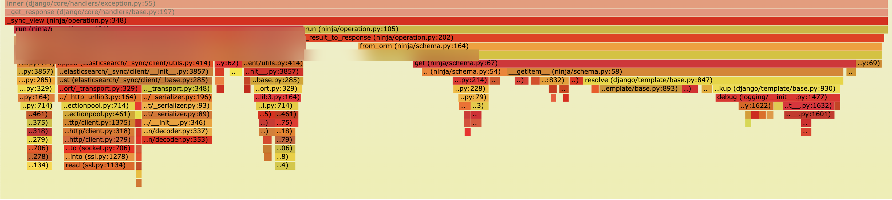
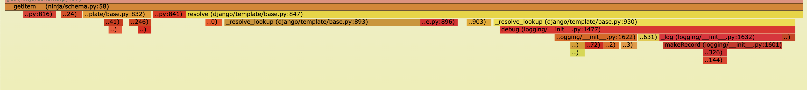
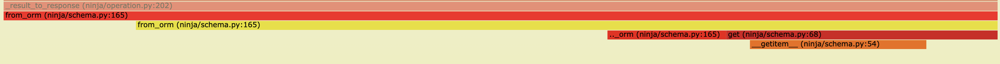
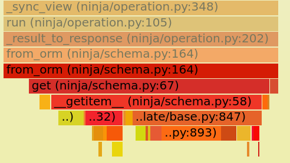
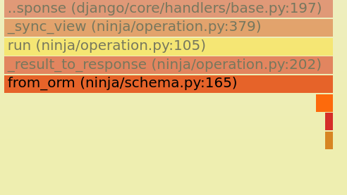

검색 API에서 요청을 처리하고 응답을 만들 때, 실제 Elasticsearch 쿼리에 비해 CPU 시간이 유난히 길어 보일 때가 있다는 걸 알아챈 적 있나요? 시스템이 일을 빠르게 해치울 거라고 기대할 때는 특히 답답한 이상입니다. Django Ninja에서 응답을 만들 때 저도 이걸 겪었습니다. `dataclass`에서 `pydantic`으로 바꿨다가 다시 `dataclass`로 돌아와도(네, 이런 일이 있었습니다) 문제는 남았습니다. Django Ninja가 요청과 응답에 `pydantic`을 쓰니, 범인은 프레임워크 안에 숨어 있는 무언가일 거라고 의심했습니다.
# Profiling with Py-spy
더 분명하게 보려고, 가벼운 프로파일러인 `py-spy`([GitHub 링크](https://github.com/benfred/py-spy))를 썼습니다. 결과가 눈을 뜨게 했습니다. 아래는 API 호출 10번 정도의 스냅샷입니다. 맨 오른쪽에 응답을 만드는 구간인 `_result_to_response` 함수가 보입니다. 정확한 지연은 안 나왔지만, 이 과정이 실제 검색 쿼리만큼이나 오래 걸리고 있었습니다.



조금 더 쪼개 봅시다.
# Unveiling the Culprit: Field Mismatches

이 스냅샷에서:


파생 스키마 필드를 계산하는 데 쓴 시간 비중이 눈에 띕니다. 크지는 않지만, 검색처럼 필요 없을 때 계산을 건너뛰면 상당한 최적화로 이어질 만큼 자원을 씁니다. 하지만 이게 주된 문제는 아니었습니다.



다음으로 큰 시간 싱크는 응답 자체 생성입니다. 이 일을 하는 코드를 들여다보면, 범인이 보입니다:

```python
try:
    item = getattr(self._obj, key)
except AttributeError:
    try:
        item = Variable(key).resolve(self._obj)  # 1
    except VariableDoesNotExist as e:
        raise KeyError(key) from e
```

여기서 중요한 부분은 `resolve` 함수입니다. 코드가 `except` 블록으로 들어가 `item`을 다시 계산합니다(코드의 #1). `key`가 객체에서 발견되지 않아서, 다시 찾도록 강제되기 때문입니다. 이런 키에는 다음 같은 필드가 포함됩니다:

- z0
- z1
- z2

Django Ninja가 `dataclass`에 없는 필드를 Django 템플릿의 `resolve()` 메서드로 해석하려 해서, 추가 지연이 생깁니다.

Django Ninja 저장소에 [이슈를 자세히 남겼습니다](https://github.com/vitalik/django-ninja/issues/886). `dataclass`와 응답 스키마의 이 불일치가 DjangoGetter로 하여금 맞지 않는 필드에 느린 `resolve()` 과정을 쓰게 만든다고 적었습니다.

### Real-world Example and Profiling Insights

우리 프로젝트에서는 `dataclass`에 정의된 필드와 API 응답에 쓰는 스키마의 불일치를 다룰 때 이 이슈를 알아챘습니다. 프로젝트의 단순화한 구조는 이렇습니다:

```
ninja_test/
|- dataclasses.py
|- schemas.py
|- urls.py
|- views.py
```

`dataclasses.py`에서:
```python
from dataclasses import dataclass
from typing import Literal

@dataclass
class Data:
    x: int
    y: int = 0
    z: Literal[0] = 0
```

`schemas.py`에서:
```python
from typing import Literal
from ninja import Field, Schema

class HelloData(Schema):
    x: int = 0
    y: int = Field(0)
    z: Literal[0] = 0
    z0: Literal[0] = 0
    z1: Literal[0] = 0

class HelloResponse(Schema):
    data: list[HelloData] = []
```

이 설정에서는 응답 스키마에 `z0`, `z1` 같은 필드가 있고 `dataclass`에는 없습니다. `py-spy`로 콜 스택을 프로파일했을 때, DjangoGetter가 이 없는 필드를 해석하느라 상당한 시간을 써서, 눈에 띄는 지연을 만드는 것을 볼 수 있었습니다.

`py-spy`가 만든 콜 스택을 가까이 보면:



하지만 없는 필드를 딕셔너리로 직접 넘기니, `Variable(key).resolve(self._obj)`가 만들던 지연이 완전히 사라졌습니다. `views.py`의 수정된 코드는 이랬습니다:

```python
@router.get("/hello", response=HelloResponse)
def hello(request):
    data = [asdict(Data(x=1)) | {"z0": 0, "z1": 0}]
    return {"data": data}
```

없는 값을 명시적으로 넣어서, `resolve()`가 필요 없게 우회했고, 검색 API의 응답 지연을 30% 줄였습니다. 아래 py-spy 프로파일 비교에서 이를 볼 수 있습니다:

명시적 할당 전 콜 스택:


명시적 할당 후 콜 스택. 콜 스택이 사라졌습니다.

### The Final Fix: Explicit is Better than Implicit

결국 해결은 단순했습니다: 명시적이어야 했습니다. 원래 `dataclass`에 없던 필드에 값을 수동으로 줘서, Django Ninja의 `resolve()` 메서드가 만들던 성능 병목을 없앴습니다.

이 동작이 Django Ninja의 의도인지는 불분명하지만, Django Ninja 메인테이너에게 이슈를 올렸습니다. 공식 [GitHub 이슈](https://github.com/vitalik/django-ninja/issues/886)에서 논의를 따라갈 수 있습니다.
# Conclusion

코드를 프로파일하고 분석하는 시간을 들이면, 그렇지 않으면 놓칠 숨은 비효율을 찾아낼 수 있습니다. 이 경우에는 `dataclass`와 응답 스키마의 불일치가 상당한 지연 이슈로 이어졌습니다. 하지만 명시적 필드 할당으로 바꾸어, 검색 API의 응답 지연을 30% 줄였습니다.

Django Ninja 프로젝트에서 설명되지 않는 느려짐을 겪고 있다면, 비슷한 이슈가 있는지 확인하고 비슷한 수정을 적용해 보기를 강하게 권합니다.
