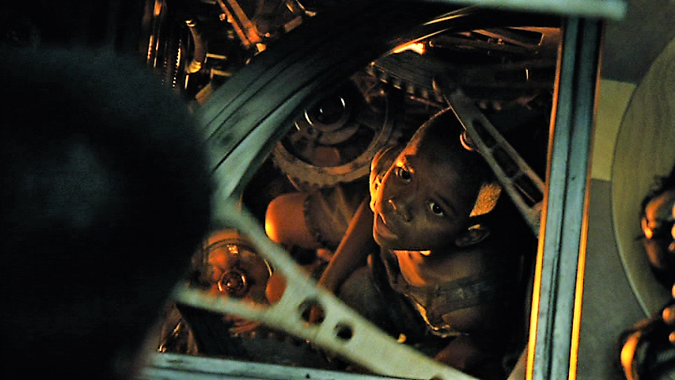
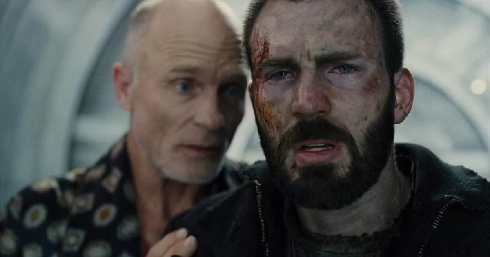

영화 "*설국열차*"를 보신 적 있나요? 처음 듣는 영화라면, 제가 좀 도와드릴게요. "설국열차"는 완벽하게 설계된 기차의 이름입니다. 영원한 겨울을 견디도록 설계되어 있습니다. 영원히 달리도록 되어 있죠. (모든 엔지니어의 꿈 같기도 하죠?).

하지만 현실 세계에 영구기관이 존재할 수 없듯이, 영원한 것은 없다는 자연의 법칙이 여기에도 적용됩니다. 얼마 지나지 않아 어떤 부품들이 *멸종*했습니다. 멸종은 그 상황에서 동물에게만 적용되는 개념이 아니었습니다. 설계할 엔지니어와 만들 재료가 없으면, 차디찬 물건에도 멸종이 적용될 수 있습니다. 이 가혹한 상황에서, 무언가, 혹은 *누군가*가 그 문제를 처리해야 합니다. 석기 시대 같은 아주 아주 먼 옛날부터, 육체 노동이 많은 문제를 풀어 왔습니다. 그들에게도 그렇게 적용됐습니다. 이번 해결책은, 엔진룸 아래 상자만 한 공간으로 아이를 내려보내는 것이었습니다.

솔직히 말하면, 우리 소프트웨어 엔지니어들도 이런 상황을 자주 만납니다. 일의 많은 부분이 육체 노동이 됩니다. 대부분의 회사는 작게 시작하고, 작은 회사는 반짝이는 도구와 방법부터 갖추고 시작할 수 없습니다. 여기에 최적의 선택은 없고, 때로는 무엇이 최적인지 결정할 시간조차 없습니다. 모두가 잘 닦이고, 충분히 논의되고, 자동화되고, 끝까지 따져 본 방식으로 모든 문제를 푸는 이상적인 세계를 상상할 수는 있습니다. 자원이 좀 들더라도요. 하지만, 글쎄요, 그건 정말 "이상"입니다.

저도 소프트웨어 엔지니어로 일하기 시작한 지 1년차, 2년차쯤에는 그렇게 순진했습니다. "내가 일하는 회사의 대부분은 자동화할 수 있어. 소프트웨어 엔지니어가 있는 이유가 그거 아니야!" 이런 식이었죠. 그리고 가끔은 수동 작업을 해야 한다고 말한, 나보다 오래 일한 동료들의 말을 듣지 않았습니다. 회사 ROI나 나 자신의 ROI는 신경 쓰지 않았습니다.

현실에서는 때로는 회사에 계획하고 실행할 자원이 없습니다. 당장 가능한 최소 자원으로 할 수 있는 일이라면, 회사가 노동자들에게 문제를 수동으로 처리하라고 밀어붙여야 할 때도 있습니다. 대부분의 경우 사람들은 자동화를 좋아하고 그걸 이루고 싶어 하지만, 단순히 그럴 자원이 없을 수도 있습니다.

문제가 제때 다뤄지지 않으면, 어떤 수동 작업은 추한 과거의 잔재로 남아서, 누군가가 그 열쇠를 쥐어야 합니다. 옛말처럼, "돌아가면 건드리지 마라." 곧 그 작업을 자동화하려는 계획은 다른 중요한 일보다 우선순위가 밀리고, 사람들은 지금 방식이 정석이라고 생각하기 시작합니다. 그러면 "엔진룸 키드"가 태어납니다. 그 사람이 없으면 회사 일이 밀립니다.

이 아이 역할을 맡는 것은 스스로에게 영광스러운 느낌을 줄 수 있습니다. 생각해 보세요. 당신이 없으면 회사가 심한 고통에 빠질 수도 있다고요! 아주 중요한 사람이 된 기분 아닌가요? 그 레벨이 아니어도, 회사에 대한 C-레벨급 중요도입니다. 수동 작업을 하느라 삶을 희생하는 느낌이니, 그 일을 하는 것이 거의 성스럽게 느껴집니다.

하지만, 그걸 영광으로 받아들여서는 안 됩니다.

# Curtis

현실 세계에서 최소한 반영구적이지 않은 것은 많지 않고, 어떤 산업이든 마찬가지입니다. 엔진룸 키드는 결국 자라고, 커지고, 팔다리와 몸통이 자라서, 그 좁은 상자에 몸이 더 이상 들어가지 않게 됩니다. 곧 그 아이는 그 일에 맞지 않습니다.  아니면 새로 생긴 문제 때문에 일 자체가 바뀌어서, 아이가 더 이상 그 일에 맞지 않을 수도 있습니다. 어느 쪽이든, 그 아이는 더 이상 유용한 도구가 아닙니다.

더 나쁜 점은, 상자에서 나와도 갈 곳이 없다는 것입니다. 혼자 살아갈 기술이 있나요? 없습니다. 글쎄요, 적어도 스패너 같은 걸 다루는 데는 신동처럼 되겠지만, 그에게서 괜찮은 사회성을 기대하기는 어려우니, 그 사람은 슬프고 슬픈 발달 저하를 안고 살아야 합니다.

수동 작업을 계속하는 것을 즐기려는 에고가 그와 같습니다. 이 "엔진룸 키드"가 되는 것은 자신에게 이롭기 어렵고, 그 일 자체도 결국 레거시가 됩니다. 에고는 자기 계발의 가장 큰 적 중 하나입니다. 성스러운 수동 작업을 좋아하게 만들 수도 있습니다. 떠나지 못하게 눈을 가릴 수도 있습니다.

하지만 다행히, 이 산업에는 이미 이 상황에 대한 베스트 프랙티스가 나와 있다고 생각합니다. 닫힌 시스템 안의 문제에 대한 해결책은, 시스템 밖에서 해결책을 들여오는 것입니다. 누군가 눈이 가려져 있다면, 다른 사람이 그 눈이 되어 줄 수 있습니다. 다른 사람들이 무엇을 하는지 들여다볼 방법은 이미 알고 있습니다. 주기적으로 스탠드업을 하고, 커피챗을 하고, 격주로 회고를 하면 됩니다. 그들의 문제를 풀어 주고 노동에서 벗어나게 해 주는 것이 최선이겠지만, 비즈니스 상황에서 남이 그렇게 해 주기를 보통 기대하지는 않습니다. 당신이 보는 진실을 말해 주도록 그 사람을 툭 건드리는 것만으로도 관점이 바뀔 수 있습니다.

영화에서 주인공 커티스는 팔을 희생해서 아이를 구합니다. 할 수 있다면 커티스처럼 하세요. 아이를 구하되, 어느 정도의 트레이드오프는 각오하세요. 하지만 할 수 없다면, 괜찮습니다. 그렇게 계속 일하지 않아도 된다고만 말해 주세요.

마무리하기 전에, 한 가지 더 기억해야 할 것이 있습니다. 일은 *당신*이 엔진룸 키드가 되어 달라는 요청을 받기 전까지는 무섭지 않습니다. 엔진은 계속 돌아가야 하고, 다른 말로 쇼는 계속되어야 하니, 누군가가 그 열쇠를 쥐어야 합니다. 그때가 왔는데 아무도 준비하지 않았다면, 같은 상황이 반복됩니다. 당신은 그럴 필요가 없습니다.
