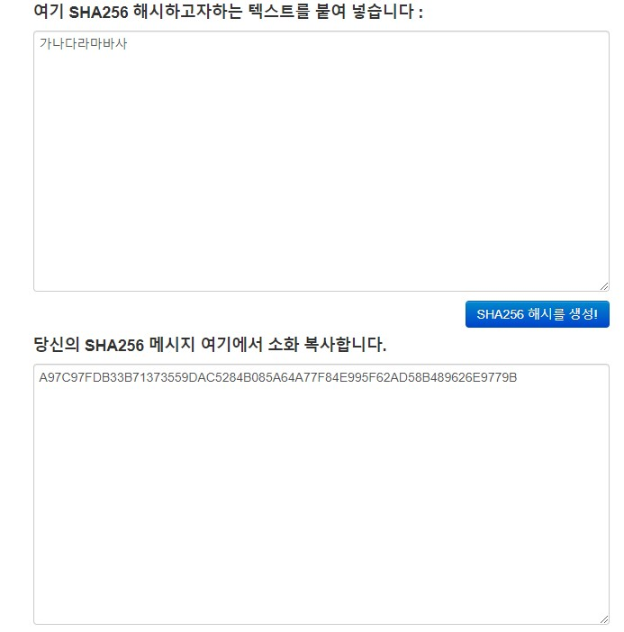
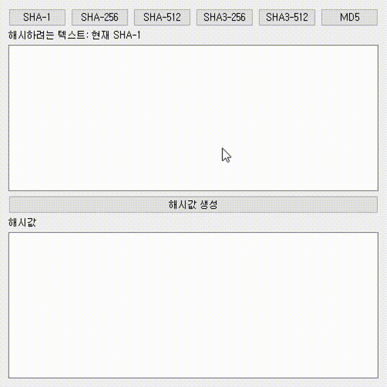

Contents
===
> * 1.Cryptographic hash functions?
> * 2.PyQt5 usage guide
> * 3.How to use PyInstaller
> * 4.Progress

1.Cryptographic hash functions?
==============
A cryptographic hash function, according to [Wikipedia: Cryptographic hash function][1]:

> * A cryptographic hash function is a kind of hash function, meaning the case of having the property that it is difficult to find the relationship with the original input value from the hash value. *

For example, if a hash function is like y=x, where it's easy to know the key value (x) from the hash value (y), it cannot correspond to a cryptographic hash function. When you send a hash value in an encrypted state, it would inevitably be vulnerable to hacking attacks.

An encryption function must satisfy the following three properties.

For the writer's convenience, the explanation below assumes that for hash function f, key value x, and hash value y, the relationship y=f(x) holds.

1. Preimage resistance: using some y, finding x is computationally difficult.
2. Second preimage resistance: when there is a y corresponding to some x, changing x without changing y is computationally difficult.
3. Collision resistance: safe against hash collisions. Finding different x's that generate some y is computationally difficult.

In other words, I think it can be summarized as below.

1. Reverse calculation using the hash value should be difficult
2. When a key value different from the existing key value is input, a hash value different from the existing hash value should be output
3. Finding collisions (different keys that produce the same hash value) should be computationally difficult. (By the pigeonhole principle collisions always exist.)

There's a [decent example described by JSPark][2] about this, and to briefly summarize, a function that is not a 1:1 correspondence like y=f(x)=x^2 has f(2)=f(-2)=4, so the key value-hash value is not a 1:1 correspondence and it's hard to know the original value.

Kinds of cryptographic hash functions
---------------------
**Kinds of cryptographic hash functions** include SHA-0, SHA-1, SHA-256/224, SHA-512/384, SHA3-256/224, SHA3-512/384, MD5.

SHA-0 is a function designed at NSA in 1993, and its official name is SHA (Secure Hash Algorithm) but it's written as SHA-0 for distinction, and SHA-1, SHA-256/224, SHA-512/384 are variants of SHA-0. For SHA-1 an actual collision was found with the SHAttered attack in 2017, and it is currently in a deprecated state.

The SHA-3 family is an algorithm that relatively recently, in October 2012, won first place in a competition and was selected as a standard, and NIST published the SHA-3 standard in 2015. SHA-3 was selected as a backup with a different structure from SHA-2 after the SHA-1 attack, not because SHA-2 is about to be broken. NIST still sees SHA-2 as a secure hash algorithm. ([NIST, 2012](https://www.nist.gov/news-events/news/2012/10/nist-selects-winner-secure-hash-algorithm-sha-3-competition))

According to a [2012 article][3], SHA-2 would have no problem being used for general purposes for a certain period. I don't know much about coins or blockchain but an example that uses the SHA-2 family is Bitcoin, and I think it would be used in various other fields as well. Looking at the fact that the coin side, where security should be thorough, still uses the SHA-2 family, I wonder if the security issue is not yet that large.

Besides that there's the MD5 algorithm, and according to [Wikipedia: MD5][4], already in 1996 a security issue with MD5 was found and using another algorithm was recommended, and in 2008 it was announced that it was possible to forge SSL certificates using MD5's flaws.

Hash vs encryption
--------------
Making a hash value and encryption are different.

If you make a hash value you cannot know the original value. As explained above, a cryptographic hash function should make it difficult to know the key value using the hash value.

Encryption, when you encrypt an input value, should be decryptable.

Then you get curious where and how hash values are used. You can't remake the original value, so where do you use it?

According to [material organized by se-you][5], when storing passwords in a database, it's also used for the purpose of putting the password into a hash function and storing the resulting hash value in the database. But a regular hash without salt is not safe for password storage. For passwords you should use a slow KDF with salt like bcrypt, scrypt, argon2.

hashlib
---------
Fortunately, if you use Python, hash algorithms are provided in a library called hashlib!
[Official link]:https://docs.python.org/3/library/hashlib.html

There's SHA-1 through SHA3-256, and MD5 and other cryptographic hash functions are provided.

2.PyQt5
====================
PyQt5 is a GUI library you can use in Python.

Originally the GUI library you can use in C++ is Qt, and they say they ported this library to Python and developed it into a library that can keep Python's conciseness.

In practice, having tried it, it's extremely convenient and I think it's an excellent library that can help you easily enter the world of GUI.

The basic guide is well described in the PyQt5 Tutorial written by Dardo ([wikidocs link][6]) so I'll refrain from additional description. If you follow the described contents, even if your Python skill isn't particularly high, you'll be able to make a usable GUI application.

If my skills grow and I have time left, I should try writing a guide myself.

3.PyInstaller
=============
If you've made a GUI program using PyQt5, you want to make it so it can run as an exe file for ease of use. The solution in this case is PyInstaller.

Basic usage
------------
PyInstaller is a library that turns .py files into executables, and it's also simple and easy to use. The basic usage is well described in the PyQt5 wikidocs above, but to briefly summarize it's as follows.

* Install
> pip install pyinstaller

* Basic usage
> pyinstaller test.py

If you run the command, a dist/ folder is created in the folder where test.py is located, and the executable is located inside this folder.

Additional options
----------
The test.spec file created at this time is a file that instructs how to create the exe file, and if you change the constants inside this file 'appropriately' you can make changes like changing the app name.

If you run it without any options at this time, a black cmd window comes up together at runtime, and not only the exe file comes out but several files exist together inside the dist folder.

If you want to only bring up the program window, add the --windowed option.

* Only bring up the GUI program window
> pyinstaller --windowed test.py

If you want only one exe file to come out rather than several files, add the --onefile option.

* Only the exe file
> pyinstaller --onefile test.py

If you want to set the exe file's icon, add the --icon *icon location* option.

* Icon
> pyinstaller test.py --icon icon.png

Issues related to PyQt5
-------------------
I don't really know why, but there's an issue where the exe file doesn't run properly when using PyQt5 together.

If it doesn't run well, paste all of PyQt5's bin files into [.py located folder]/dist/[app_name]/PyQt5/Qt/bin/.

You get all of PyQt5's bin files from the folder where you installed Python, and the specific location is [Python install location (ex:C:\Python37)]/Lib/site-packages/PyQt5/Qt/bin/.

For reference, if you run the exe from the CLI you can see the error message, so please make good use of it.

4.Progress
===========
The client requested a program that, using a cryptographic hash function, shows the hash value when you input a key value.

The picture they showed as an example was as follows, and they probably requested it after seeing an [online hash generator page][7].

As a result of looking it up, as described in 1.Cryptographic hash functions there were many hash functions, and I thought there would definitely be a library in Python so I looked it up and found that hashlib provides a sufficiently large number of cryptographic hash functions. So while I was at it I thought I could do about 6 together and proceeded.

The result of making it is as follows.

I finished the program more simply than I thought, and I think it was entirely thanks to the simplicity of PyQt5 and hashlib.

The code is public, and you can check it at the following link ([link][8])

[1]: https://ko.wikipedia.org/wiki/암호화_해시_함수
[2]: https://jsungpark.tistory.com/35
[3]: https://www.boannews.com/media/view.asp?idx=33102&kind=1
[4]: https://ko.widipedia.org/wiki/MD5
[5]: https://se-you.tistory.com/11
[6]: https://wikidocs.net/book/2165
[7]: https://www.convertstring.com/ko/Hash/SHA256
[8]: https://github.com/yangkyeongmo/hash_encription
